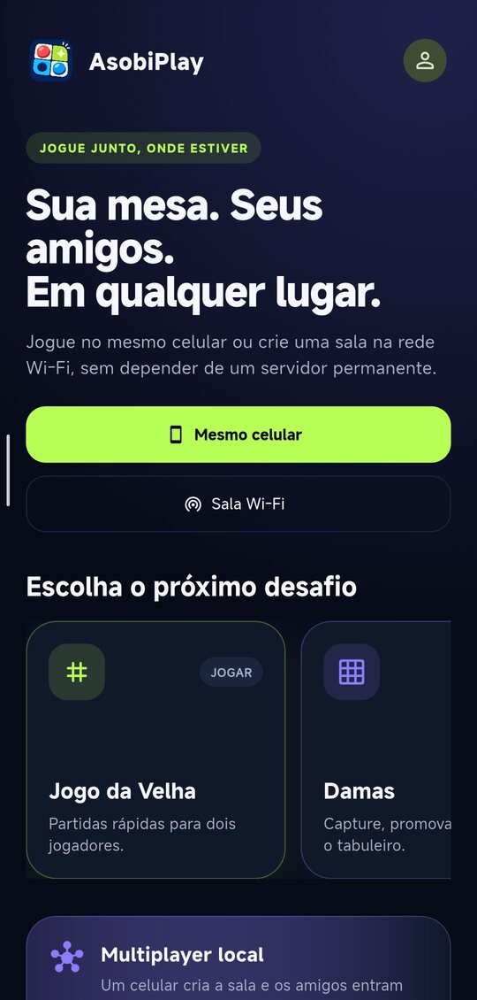
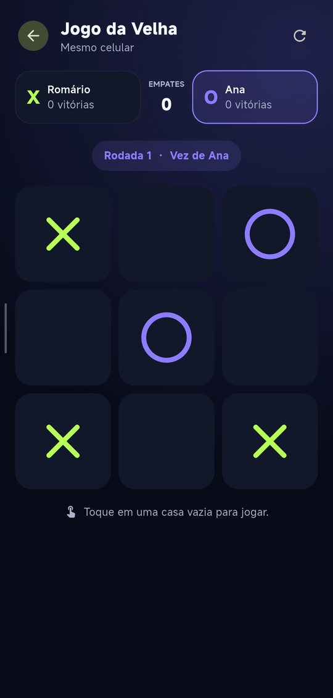
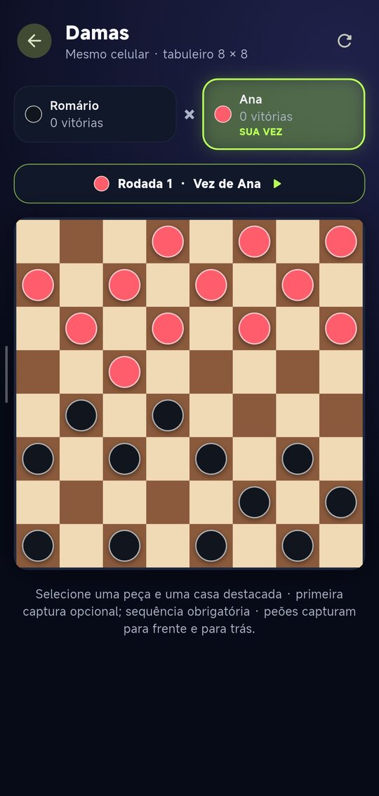
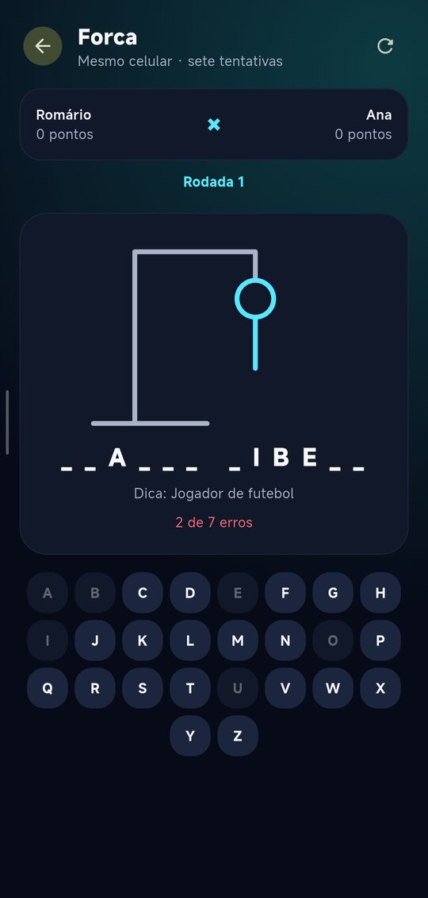
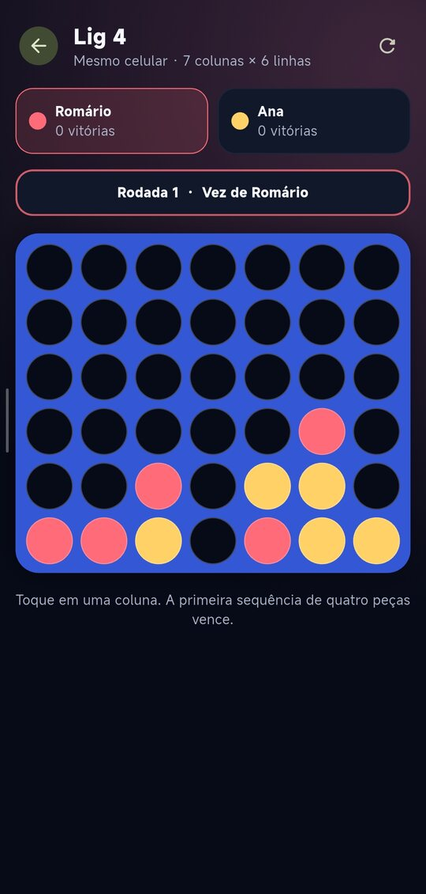

# AsobiPlay

[Português](README.md) | [English](README.en.md)

A mobile board game collection for playing on the same phone or with friends connected to the same Wi-Fi network.

[](LICENSE)

> Work in progress. The current version includes Tic-Tac-Toe, Checkers, Hangman, and Connect Four for two players sharing one phone.

## Interface

<p align="center">
  
</p>

<table>
  <tr>
    <td align="center"><strong>Tic-Tac-Toe</strong><br></td>
    <td align="center"><strong>Checkers</strong><br></td>
    <td align="center"><strong>Hangman</strong><br></td>
    <td align="center"><strong>Connect Four</strong><br></td>
  </tr>
</table>

## Features

- Quick player name setup for every game.
- Tic-Tac-Toe with move validation, wins, draws, rematches, and score tracking.
- Checkers with an optional forced-capture rule, configurable backward captures, promotion, and flying kings.
- Five individual piece colors per player and three board themes.
- Hangman with a protected secret word, optional hint, and seven drawing stages.
- Connect Four with gravity and horizontal, vertical, and diagonal win detection.
- Tic-Tac-Toe multiplayer between two phones on the same Wi-Fi network.
- Room creation by code, automatic discovery, and manual connection by IP address.
- Persistent match scores and alternating roles between rematches.
- Responsive interface for Android and iOS.
- Custom visual identity and application icons for Android and iOS.

## How it works

AsobiPlay brings together quick games for playing with friends. Players can enter their names, keep a local score, and choose between two match modes:

- **Same phone:** two players share one device.
- **Wi-Fi network:** for Tic-Tac-Toe, one phone creates the room and temporarily acts as the host, with no computer or permanent server required.

To play over the local network:

1. Connect both phones to the same Wi-Fi network.
2. On the first phone, tap **Wi-Fi Room**, enter a name, and create the room.
3. On the second phone, enter a name and room code to discover it automatically.
4. If discovery fails, enter the `IP:port` address displayed by the host.

## Technologies

- Flutter and Dart
- Material 3
- WebSocket, UDP broadcast, and local network discovery
- Unit and widget tests
- GitHub Actions

## Running locally

Requirements: Flutter 3.35.2 or compatible and a configured device or emulator.

```bash
flutter pub get
flutter run
```

Validate the project:

```bash
dart format --output=none --set-exit-if-changed .
flutter analyze
flutter test
```

## Architecture

The codebase is organized by feature. Game rules are separated from the interface and local network communication, enabling isolated tests and reuse across match modes.

See the [architecture](docs/ARQUITETURA.md) and [roadmap](docs/ROADMAP.md) documents. These supporting documents are currently written in Portuguese.

## Releases

- Read the [changelog](CHANGELOG.md).
- Download published APKs from the [GitHub Releases page](https://github.com/Silva-D-Romario/asobiplay/releases).

## Development workflow

- `main`: stable releases.
- `develop`: development and validation.
- Changes reach `main` through pull requests after the automated checks pass.

## License

This project is distributed under the original [MIT License in English](LICENSE). An [unofficial Portuguese translation](LICENSE.pt-BR.md) is also available for reference.

## Author

Developed by [Romário Silva](https://github.com/Silva-D-Romario).
