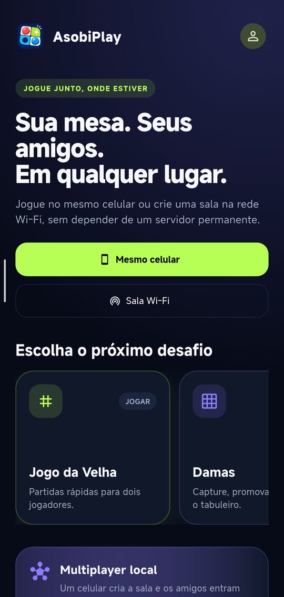
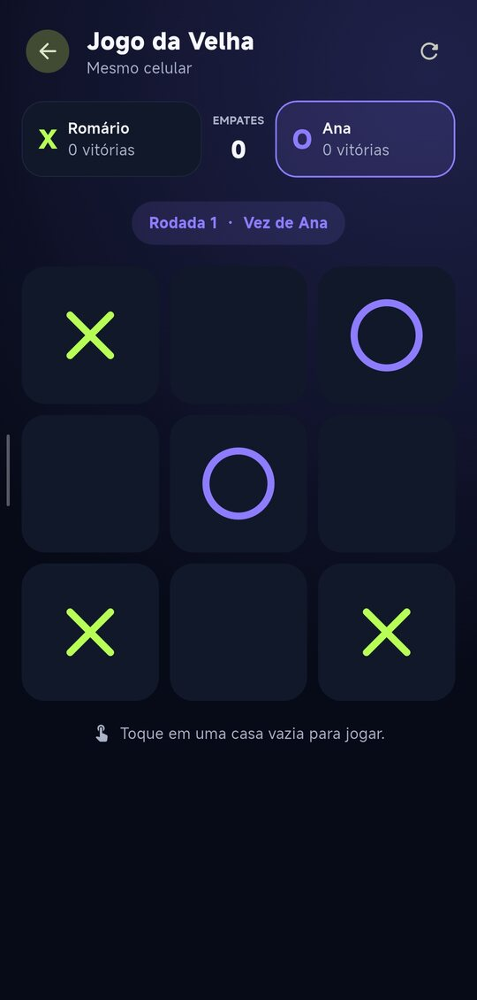
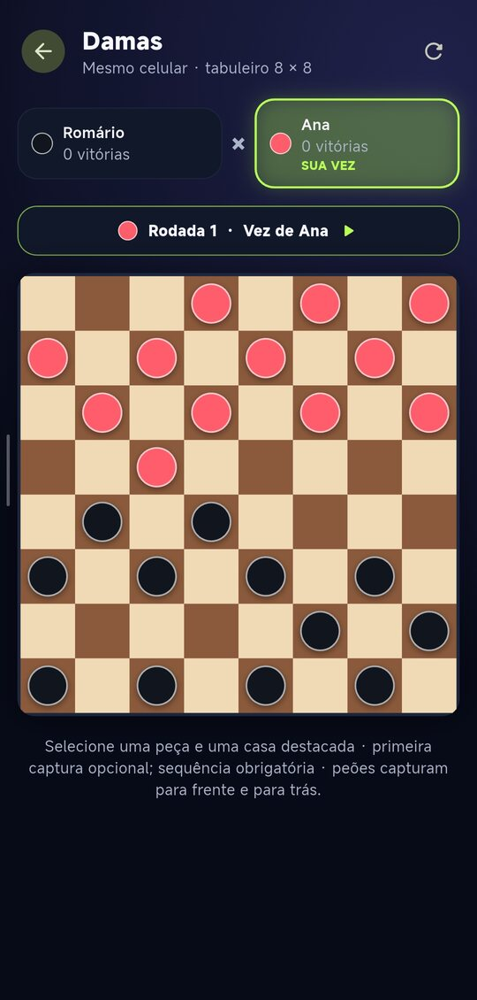
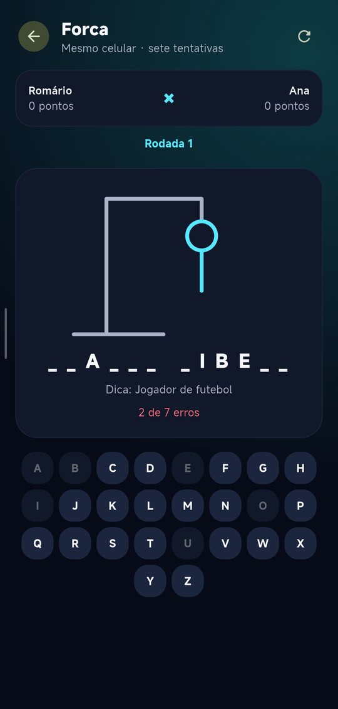
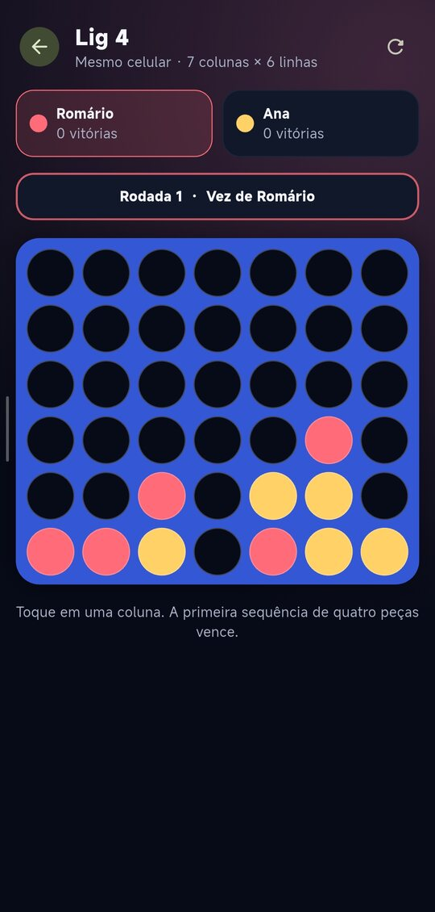

# AsobiPlay

[Português](README.md) | [English](README.en.md)

Aplicativo mobile de jogos de tabuleiro para jogar no mesmo celular ou com amigos conectados à mesma rede Wi-Fi.

[](LICENSE)

> Projeto em desenvolvimento. A versão atual permite jogar Jogo da Velha, Damas, Forca e Lig 4 no mesmo celular, além de Jogo da Velha e Damas entre dois celulares via Wi-Fi.

## Interface

<p align="center">
  
</p>

<table>
  <tr>
    <td align="center"><strong>Jogo da Velha</strong><br></td>
    <td align="center"><strong>Damas</strong><br></td>
    <td align="center"><strong>Forca</strong><br></td>
    <td align="center"><strong>Lig 4</strong><br></td>
  </tr>
</table>

## Recursos disponíveis

- Cadastro rápido dos nomes dos jogadores em cada jogo.
- Jogo da Velha com validação de jogadas, vitória, empate e revanche.
- Damas com captura obrigatória opcional, captura para trás configurável, promoção e damas voadoras.
- Cinco cores individuais para as peças de cada jogador e três temas de tabuleiro.
- Forca com palavra secreta protegida, dica opcional e sete estágios no desenho.
- Lig 4 com gravidade, sequências horizontais, verticais e diagonais.
- Jogo da Velha e Damas multiplayer entre dois celulares na mesma rede Wi-Fi.
- Configuração de regras, tabuleiro e cores de Damas sincronizada entre os aparelhos.
- Criação de sala por QR Code, código, descoberta automática ou endereço `IP:porta`.
- Placar mantido durante as partidas e alternância de papéis nas revanches.
- Interface responsiva para Android e iOS.
- Identidade visual própria e ícones para Android e iOS.

## Proposta

O AsobiPlay reúne jogos rápidos para jogar com amigos. Cada jogador pode informar seu nome, manter um placar local e escolher entre duas formas de partida:

- **Mesmo celular:** dois jogadores compartilham o aparelho.
- **Rede Wi-Fi:** no Jogo da Velha e em Damas, um celular cria a sala e funciona como anfitrião temporário, sem depender de computador ou servidor externo.

Para jogar pela rede local:

1. Conecte os dois celulares ao mesmo Wi-Fi.
2. No primeiro aparelho, toque em **Sala Wi-Fi**, escolha o jogo, informe o nome e crie a sala.
3. Em Damas, escolha também as regras, o tabuleiro e as cores das peças.
4. No segundo aparelho, informe seu nome e toque em **Ler QR e entrar**.
5. Como alternativa, use o código da sala ou o `IP:porta` mostrado pelo anfitrião.

## Tecnologias

- Flutter e Dart
- Material 3
- WebSocket, UDP broadcast, QR Code e descoberta na rede local
- Testes unitários e de widgets
- GitHub Actions

## Executar localmente

Pré-requisitos: Flutter 3.35.2 ou compatível e um dispositivo/emulador configurado.

```bash
flutter pub get
flutter run
```

Validar o projeto:

```bash
dart format --output=none --set-exit-if-changed .
flutter analyze
flutter test
```

## Arquitetura

O código é organizado por funcionalidades. As regras de cada jogo são separadas da interface e da comunicação em rede, permitindo testes isolados e reutilização nos modos local e Wi-Fi.

Consulte a [arquitetura](docs/ARQUITETURA.md) e o [roadmap](docs/ROADMAP.md) para acompanhar as próximas entregas.

## Versões

- Consulte o [histórico de mudanças](CHANGELOG.md).
- Baixe os APKs publicados na página de [releases do GitHub](https://github.com/Silva-D-Romario/asobiplay/releases).

## Fluxo de desenvolvimento

- `main`: versão estável.
- `develop`: desenvolvimento e validação.
- Mudanças entram em `main` por pull request após os testes automáticos.

## Licença

Este projeto é distribuído sob a [licença MIT original em inglês](LICENSE). Uma [tradução não oficial em português](LICENSE.pt-BR.md) também está disponível para consulta.

## Autor

Desenvolvido por [Romário Silva](https://github.com/Silva-D-Romario).
